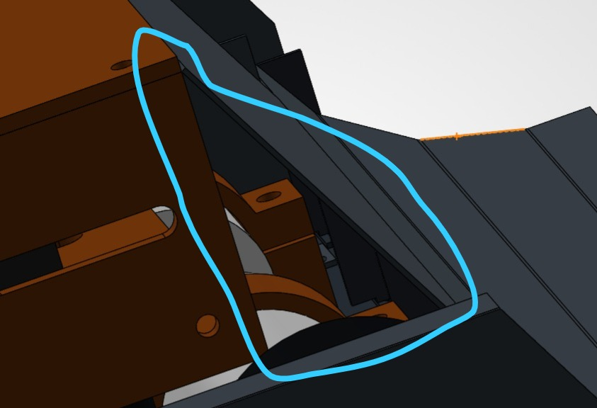
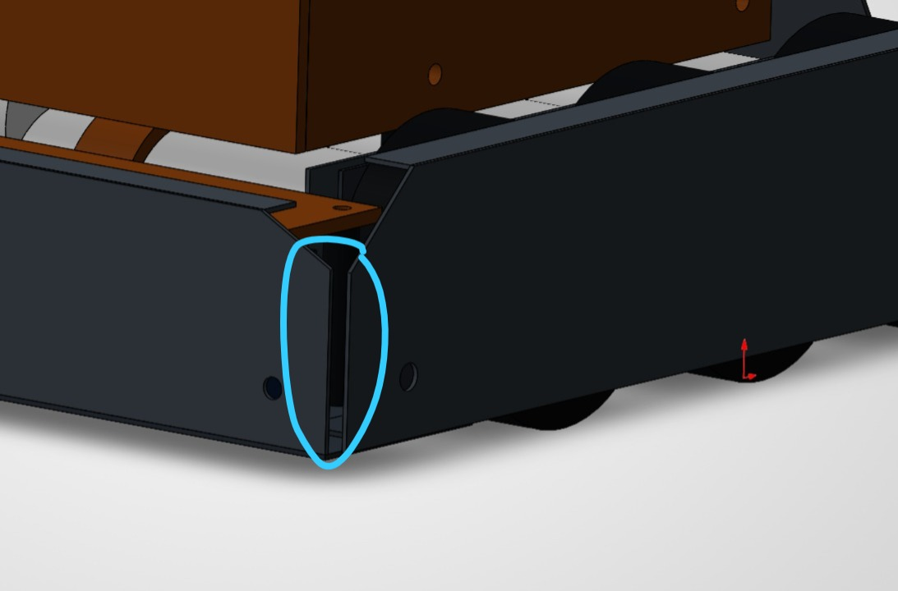

# Front support and rear corner review

7 November 2026. Review of the team's two annotated Rev B views against the saved Rev B/Rev C build notes and native verification results. The recommendations below are proposed joint work; they have not been added to the Rev C CAD or checked by a new interference run or structural simulation.

## Decision

Connect both rear corners and detail the fabrication joints before issuing the full cut job. Use folded steel returns or internal bolted steel angles where access allows. For the front, evaluate a pair of steel gussets supporting the steep upper front closure and carrying its load into structural steel. Their location must clear the wheels and gearbox screws. A larger unconnected triangular sheet would not complete the load path.

The team's welding concern is justified. Rev B represents several returns, feet and webs as separate parts and says to join them, but does not fully specify every joint, overlap, fastening pattern or weld. It is a fit prototype. The number of CAD part files is not a demand to weld every file separately: suitable plate/return pairs can become one folded component, with its own bend development and shop check.

## 1. Front triangular support

The marked area appears to border the steep upper front closure (part 19). Distinguish that panel from the lower three-bend attack scoop (part 06). The current lower scoop already has an underlay (26), five support webs (07) and five feet (08). Their modeled presence does not establish joint strength, but a new triangle is not the first support for the lower scoop.

A gusset can help restrain the upper panel and its side edge under an off-centre impact. It must connect at both ends: front steel panel to steel chassis/floor or a structural steel member. The PETG electronics riser (18), deck and lid are covers/supports for electronics, not the intended route for collision loads. The front panel ends inboard of the outer wheel guards in the current layout, so simply extending the outer guard upward does not establish that it reaches or braces the front panel.

Prefer two compact side gussets with folded attachment flanges, or removable steel brackets, after checking the assembly envelope. Extend an existing steel member if that produces a clean, shorter load path. Check the tire sweep and deformation, wheel removal, front gearbox screw access, motor terminals and cover removal. Keep attachments behind the opponent-contact face and preserve the intended scoop edge and clearance.

**Recommendation:** useful reinforcement to develop, but not an instruction to fill the entire outlined triangle. No thickness, outline, hole location or load rating is released for it yet. If the actual target is the lower scoop's outer corners, assess those corners and their unsupported spans separately rather than using the electronics cover as support.

## 2. Rear-to-side corner connection

Connecting rear wall (11) to both side guards (09) gives the perimeter a defined load path and helps resist relative movement at a corner. Closing the visible gap by changing plate length is only a fit change; strength depends on the joint that transfers force across it. A longer flat edge is not automatically a satisfactory weld detail.

Preferred routes, in order of workshop convenience:

1. Fold return flanges at the rear wall's ends and bolt them to the side guards, if the brake can form them and fasteners remain accessible.
2. Add an internal 90-degree steel angle at each rear corner. Use a fastener group on each leg, with two separated fasteners per wall as a prototype arrangement so a single bolt does not become a hinge. Size the flange, hole spacing, edge margins and backing to the actual sheet, force path and available clearance.
3. If a competent operator can weld the actual stock reliably, prepare a proper fitted joint and use an appropriate short/intermittent weld sequence in a fixture. Establish its details on scrap first.

The existing upper returns (27 and 28) stiffen panel edges, but do not by themselves specify a vertical rear-corner joint. A connected rear corner is higher priority than adding cosmetic panel area. Keep the rear armor or its corner connection removable if that helps replace collision damage or access wiring.

## 3. Welding and the 0.8-1.0 mm stock

Availability of a welding machine does not establish that its process and operator can join this thin sheet without burn-through or pulling the chassis out of alignment. A long continuous seam can add distortion and assembly difficulty. Trial the real stock and joining procedure, including clamping and weld order, before committing the chassis. This follows TWI's guidance on reducing welding distortion through joint design, fixtures and controlled/intermittent welding where appropriate. It does not set a weld size or strength rating for this robot.

Where a folded or bolted joint can meet the load path and remain accessible, it reduces reliance on welding. The following changes to manufacturing are concepts until their bend geometry, holes and access are detailed. Rev C has not been converted into an all-bolted fabrication package.

| Joint in current model | Practical next detail | Current status |
|---|---|---|
| Face rail 02 + return strip 03 | Prefer a single bent steel rail, or detail the joined L section with a squared fixture | Bend allowance / joined seam unverified |
| Scoop 06 + underlay 26 + webs 07 + feet 08 | Build a rigid metal-only nose subassembly; specify every web/skin/foot attachment and test a corner load | Joint design and physical load check open |
| Guard 09 + return 27 | Prefer an integral folded return where tooling permits; preserve wheel clearance | Forming method not released |
| Rear wall 11 + return 28 + side guards 09 | Folded end returns or two internal bolted angles, with complete fastener groups | New corner detail proposed |
| Floor 01 + hat stiffeners 25 | Specify flange-to-floor attachments and fixture the floor flat | Attachment pattern / seam open |
| Upper front closure 19 | Define support into structural steel and retain cover access; assess two gussets | New front detail proposed |
| PETG mounts, battery trays and electronics covers | Assemble with bolts, washers, spacers and nuts after the metal work | Use the existing prototype hardware list |

Make and clean the bare metal subassemblies before installing motors, printed parts, batteries or electronics. The exact joining process, metal grade, measured thickness, brake tooling and worker capability remain workshop inputs. A same-stock coupon and a simple loaded mock-up are more useful now than a simulation with guessed joint stiffness.

## Before the next fabrication revision

- Choose the shop's joining route and record which seams become bends, bolts or welds.
- Model the proposed rear corners and any front gussets; check tire, motor, fastener and cover access in the actual assembly.
- Add clear joint/fastener details and a bend table before making the new flat patterns. A projection of a bent shape is not an unfolded blank.
- Check floor flatness, all six wheel contacts, and loaded scoop clearance. Test front centre, front corner and rear corner loading for permanent set and loosened joints.

No structural strength pass is asserted here. The earlier native interference audit checks geometric intersections; it does not establish weld quality, sheet buckling, impact strength or chassis stiffness.

## References

- [TWI: preventing and correcting weld material distortion](https://www.twi-global.com/media-and-events/insights/preventing-and-correcting-weld-material-distortion), accessed 7 November 2026, sections on distortion and prevention. Used for qualitative fixture and welding-sequence guidance, not a local shop process limit.
- [Protolabs: sheet-metal fabrication design guidelines](https://www.protolabs.com/services/sheet-metal-fabrication/design-guidelines/), accessed 7 November 2026. Supplier-specific forming guidance is a reference; actual bend radius, flange limits and allowances need the chosen shop's tooling and stock.
