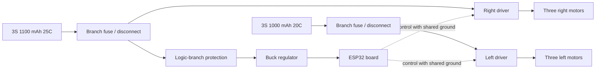

# Two separate 3S supplies

The intended architecture uses one pack and one IBT-2/BTS7960 module for each
three-motor bank. The two packs are not wired in series or directly paralleled.

Connect both pack negatives, driver grounds and control ground to a suitable
common reference. Give motor currents their own adequately sized return paths;
do not route them through ESP32 ground wires or a breadboard. Keep the two
positive motor supplies separate. Confirm the actual IBT-2 board's logic supply
and 3.3 V signal compatibility; chip ratings alone do not establish module wiring.

| Pack label | Calculated label current capability |
|---|---:|
| 1000 mAh, 20C | 1.0 Ah x 20 = 20 A |
| 1100 mAh, 25C | 1.1 Ah x 25 = 27.5 A |

These are label-derived figures, not measured safe branch currents. The three
motors share that side's pack capability. Higher C does not force extra current
into the motors. Different internal resistance, charge and age can cause unequal
voltage sag during pushing and a steering bias. ESP32 consumption is additional
on its branch; attaching it to the larger pack does not guarantee balanced sides.

A normal 3S LiPo is 11.1 V nominal and 12.6 V fully charged. Never apply it directly
to ESP32 3.3 V. Use a regulated supply suited to the exact board. For a development
board with a supported 5 V input, a 5 V buck rated at least 1 A is the proposed
starting specification. Check regulation and transients with motor starts before
connecting it to the board. Avoid simultaneously back-feeding USB and the board
input unless its schematic permits it.

Charge the packs separately with the correct balance charger and monitor both
packs/cells independently during use. Determine wire, connector and fuse ratings
from measured startup/pushing current and their datasheets. Driver thermal/current
protection does not replace battery low-voltage monitoring or branch protection.

Record: pack voltages under the same manoeuvre, current per side, regulator voltage
and ESP32 resets, connector/driver/motor temperatures, straight tracking and loss
of control stopping behaviour. No three-motor branch-current or failsafe result
has been recorded by this repository update; the electrical validation stays open.

Sources: [battery C rating](https://www.grepow.com/high-discharge-rate-battery/20c-high-power-lipo.html),
[ESP32 supply guidance](https://docs.espressif.com/projects/esp-hardware-design-guidelines/en/latest/esp32/schematic-checklist.html),
[BTS7960 datasheet](https://www.infineon.com/assets/row/public/documents/10/57/infineon-bts7960-ds-en.pdf).
